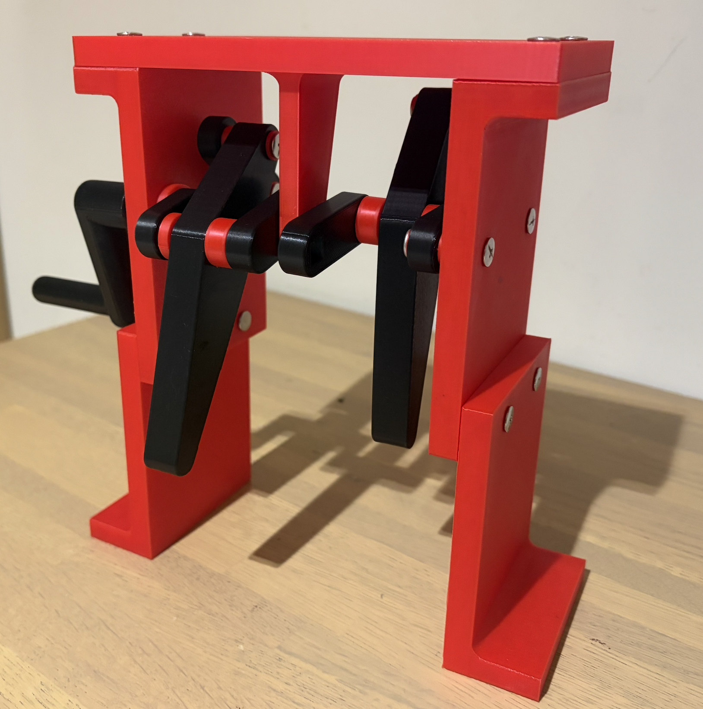
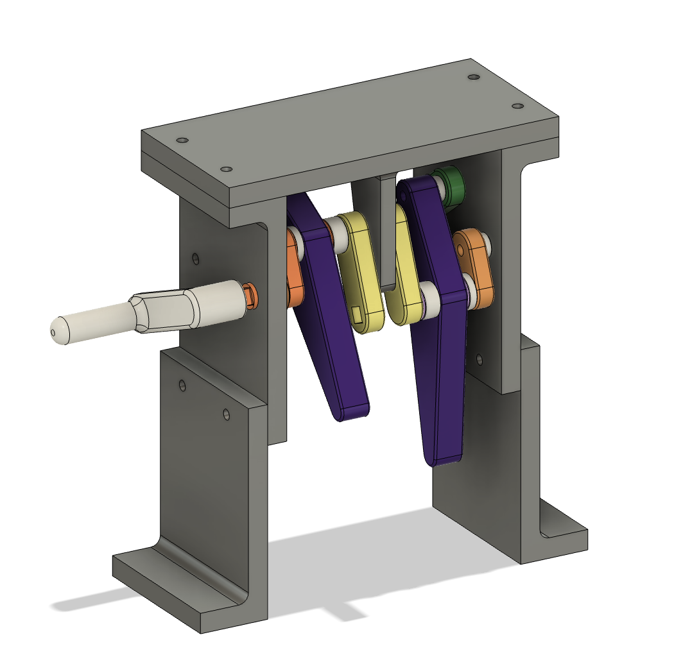

# Stair-Climbing Robot

A legged walking mechanism for automating agricultural work on terraced and stepped terrain, where wheeled and tracked machines cannot operate.

## Motivation

Terraced and mountain farming supports communities growing grains, potatoes, fruit and coffee, but it remains largely manual because tractors cannot handle steps and steep slopes. Legged robots can. This project develops a one-tenth-scale legged robot in two phases:

- **Phase 1:** hand-cranked walking mechanism that advances a stepped rack (complete)
- **Phase 2:** self-contained motorised robot that climbs steps and performs a secondary farming task (in progress)

---

# Phase 1: Hand-Cranked Walking Mechanism

## Goal

Design a stationary legged mechanism that, when its crank is turned continuously, advances a spring-loaded stepped rack, simulating a robot walking up stairs. The rack slides back when unsupported, as a robot would fall down the steps.

## Test Rack

| Top view | Side view | Front view |
|---|---|---|
|  |  |  |

| Parameter | Value |
|---|---|
| Step rise | 3.7 ± 0.3 cm |
| Step run | 8 ± 0.5 cm |
| Rack tread width | 10 cm |
| Bias | Spring returns the rack backward when free |

## Requirements

1. Advance the rack continuously while the crank is turned
2. Prevent the rack from sliding back between steps
3. Generate at least 2 N of horizontal force against the return spring
4. Driven by a single hand crank, with no other input power

## Constraints

- Remain within a 24 × 24 × 24 cm envelope at all times, including swept motion
- Clamp to the table beside the rack without touching the rack or its frame
- No simple machines operating in isolation; no Jansen or Klann linkages
- Safe: no fast-moving or sharp components
- $60 budget

## Design

### Linkage

- Crank-rocker four-bar leg (Grashof), with the foot on an extension of the coupler
- Link lengths: ground 50.7 mm, crank 18.7 mm, coupler 48.5 mm, rocker 39.6 mm
- Stride matched to the 88.1 mm step pitch; O2 and O4 pivots 153 mm above the table
- Two legs 180° out of phase, so one foot always holds the rack while the other returns

### Frame and Assembly

| Full assembly | Frame |
|---|---|
|  |  |

- Two-sided frame with a centrally supported crankshaft, removing the shaft-leg interference of a one-sided layout
- Stepped frame walls that clear the rack's side walls while keeping the legs close together
- Stainless barrel-fastener pivots, with spacers to remove axial play
- 15 mm thick legs for out-of-plane stiffness
- Crank links printed with integral rods to eliminate a toleranced fit

## Development

| Single-leg 3D-printed prototype | Final two-leg build |
|---|---|
|  |  |

Process: cardboard linkage prototypes → coupler-curve simulation → single-leg 3D-printed prototype → two-leg CAD iterations → final PLA build.

## Result

Clamped beside the rack, the prototype advanced it continuously under continuous cranking, with the two legs holding it against the spring between steps.

[VIDEO]

---

# Phase 2: Motorised Robot (In Progress)

## Goal

A self-contained, battery-powered legged robot that climbs a series of steps itself while performing a synchronised secondary agricultural task.

## Planned Approach

- Carry the Phase 1 linkage forward as the robot's legs, adding leg pairs at different phases for stability under the robot's own weight
- Replace the hand crank with a motor driving the same crankshaft
- Drive the secondary task from that crankshaft so it stays synchronised with walking

---

## Repository Structure

| Folder | Contents |
|---|---|
| `cad/` | Fusion 360 (.f3d) files for every printed part: frame, links, spacers, fasteners |
| `simulation/` | Four-bar linkage definition (JSON) |
| `reports/` | Phase 1 design reports |
| `media/` | Images and test video |

## Team

Will Garber, Kavish Mistry, Daksh Bhaskar, Kashvi Kunder
